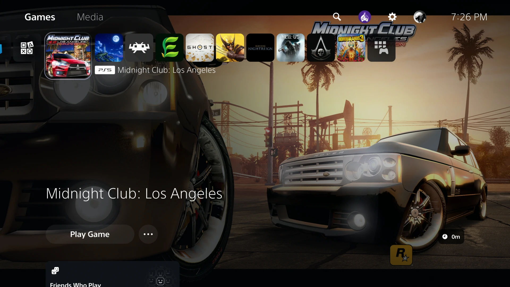

# MCLA

Static recompilation of *Midnight Club: Los Angeles Complete Edition* (Xbox 360, title 545407F8) to native code, for Windows, Linux and jailbroken PS5 consoles.



*Installed on a jailbroken PS5. The tile here is one the user supplied at build time; the background is made from the art on their own disc.*

**This repository contains no game code, assets or keys.** You supply your own legally obtained copy; a script extracts what is needed on your machine, and the recompiled code is generated locally and never committed. What you build is for you, not for sharing.

## Status

| Target | State |
|---|---|
| Windows, Direct3D 12 | Plays: career, races, garage and upgrades, with audio and a controller, at 30 FPS by default. |
| Windows, Vulkan | Reaches the title screen; not tested further. |
| Linux, Vulkan | Builds and plays natively: free roam holds 30 FPS on an Intel Core Ultra 5 238V laptop (Mesa ANV). Tested by one user. |
| PS5 (jailbroken) | Plays at a steady 30 FPS on a PS5 Pro (firmware 13.42); the zoomed-out map runs at 20 to 25. Also installed from scratch and played on a PS5 Slim (firmware 12.70). |

Car reflections are fixed on every renderer (cars no longer come out white with a glow at night):


## Which release of the game

Only **Midnight Club: Los Angeles Complete Edition, USA/Europe, for Xbox 360** (title id `545407F8`), as a disc image (`.iso`). The fixes in `config/` are addresses in that release's executable; another region or revision would need them checked again.

## How it works

The game's PowerPC code is translated to C++ ahead of time by the [ReXGlue SDK](https://github.com/rexglue/rexglue-sdk) (BSD-3, derived from Xenia), which also provides the Xbox 360 kernel, GPU and audio reimplementation. This repository holds the project manifest, function hints, a small host application, patches to the SDK and the build scripts.

## Windows

You need Windows 10 or 11 (x86-64) with a Direct3D 12 graphics card, and about 20 GB of disk. In PowerShell:

```powershell
git clone https://github.com/holdmysocks/mcla-recomp.git
cd mcla-recomp
.\scripts\make_pc.ps1 -Iso C:\path\to\your.iso
```

The script checks for Git, CMake, Ninja, Python 3, Visual Studio Build Tools 2022 (C++ workload) and the project's own Clang 20, and offers to install what is missing (answer `y`, or add `-InstallTools`); the Build Tools ask for administrator rights. It then clones and patches the ReXGlue SDK v0.10.0, builds it (the long step, once), extracts your game into `game\`, recompiles it and builds `out\build\win-amd64-release\mcla.exe`. Each step is skipped when its result is already there, so after a failure or an update you run the same command again. Logs are in `out\logs`.

**Play:** double-click the **Midnight Club Los Angeles** shortcut the build leaves in the repository folder, or `mcla.exe` itself. Keep the folder where it was built; the game data is read from `game\`. An Xbox or PlayStation controller works.

Options go after the program name, for example `mcla.exe --fullscreen=true --mcla_fps=60` (30, 60, 120, or 0 for uncapped). `--resolution_scale=3` renders the game internally at 4K, 2 at 1440p and 1 at 720p (whole multiples of the game's 1280×720 framebuffer; 1080p is not an integer scale). Native 4K is GPU-bound on most cards. The pause menu has three extra entries: DISPLAY (render scale, frame-rate target, vsync, fullscreen, motion blur, depth of field), PERFORMANCE (detail options) and CONTROLS (button prompts, intro speed); changes are saved to `mcla.toml` next to `mcla.exe`. `F8` toggles a performance overlay, off at start: FPS and frame time everywhere, plus CPU and RAM on Linux (GPU and VRAM where the amdgpu driver exposes them); the same switch is the PERFORMANCE OVERLAY row in the pause menu. DISPLAY also has QUALITY PRESET (PERFORMANCE, BALANCED, QUALITY or NATIVE 4K), which groups the options below; on Wayland the first three target 1080p output. On Linux and Vulkan, DISPLAY also has OUTPUT RESOLUTION; see the Linux section.

**Update:** `git pull`, then `.\scripts\make_pc.ps1` again.

| If | Then |
|---|---|
| The SDK build fails with `'crtversion.h' file not found` | Another Clang on your path was used. Update and run `make_pc.ps1` again: it now uses only its own. |
| Step 1 fails after downloading Clang, with `unable to run program "xz -d -qq"` | Windows 10's `tar.exe` cannot unpack `.tar.xz`. Update and run `make_pc.ps1` again: it now unpacks the archive with Python when `tar.exe` cannot. |
| Installing a tool fails with `No package found matching input criteria` | winget's package list on your PC is out of date or broken: run `winget source reset --force` in an administrator PowerShell, then `make_pc.ps1` again, or install that tool yourself (Python from python.org or the Microsoft Store works). |
| `codegen failed` | `game\default.xex` is missing or not the supported release; see the end of `out\codegen.log`. |
| The game closes by itself | Start it with `--log_file=run.log --log_level=info` and open an issue with the end of that file. |

## Linux

Tested on Ubuntu 26.04. You need Clang 20 and LLD (`clang-20`, `clang++-20`, `lld-20`), CMake 3.25+, Ninja, Python 3, Git, a Vulkan 1.3 driver, and these packages (Debian/Ubuntu names): `libgtk-3-dev libx11-xcb-dev libxss-dev libvulkan-dev libwayland-dev libwayland-bin wayland-protocols libxkbcommon-dev libdecor-0-dev libasound2-dev libpulse-dev libpipewire-0.3-dev`. Linux 6.11 or newer is recommended.

```bash
git clone https://github.com/holdmysocks/mcla-recomp.git
cd mcla-recomp
git clone --recursive --branch v0.10.0 https://github.com/rexglue/rexglue-sdk.git third_party/rexglue-sdk
cd third_party/rexglue-sdk
git apply ../../patches/rexglue-v0.10.0-mcla.patch
git apply ../../patches/rexglue-minmax-blend-factor.patch
git -C thirdparty/FFmpeg apply ../../../../patches/rexglue-ffmpeg-ps5-config.patch
git apply ../../patches/rexglue-linux-procmap-query.patch
git apply ../../patches/rexglue-linux-wait-sleep.patch
git apply ../../patches/rexglue-present-max-height.patch
CC=clang-20 CXX=clang++-20 cmake --preset linux-amd64 -DREXGLUE_USE_VULKAN=ON -DREXGLUE_ENABLE_TRACY=OFF
cmake --build out/build/linux-amd64 --config Release
cmake --install out/build/linux-amd64 --config Release
cd ../..
python3 scripts/extract_game.py /path/to/your.iso
SDK=$PWD/third_party/rexglue-sdk/out/install/linux-amd64
"$SDK/bin/rexglue" codegen mcla_manifest.toml
CC=clang-20 CXX=clang++-20 cmake --preset linux-amd64-release -DCMAKE_PREFIX_PATH="$SDK"
cmake --build --preset linux-amd64-release
./scripts/play_linux.sh
```

On Wayland, put `vulkan_allow_present_mode_immediate = false` and `vulkan_allow_present_mode_mailbox = false` in `out/build/linux-amd64-release/mcla.toml`; without them the game presents about 1,000 times a second and keeps the GPU busy.

On Wayland, DISPLAY also has OUTPUT RESOLUTION (or `--present_max_height=1080`): the swapchain is capped to that height and the compositor scales it to the window, so a 4K window can present a true 1920×1080 image. This is a presentation setting, not a render setting; RENDER SCALE still controls the game's internal resolution. With the performance overlay visible, a capped output is also cheaper to composite; without an overlay, the compositor can often present the native output directly, so measure both on your system. Mesa's X11/XWayland WSI only accepts a swapchain the size of the window, so the row is hidden on X11 and `--present_max_height` has no effect there (the log says so once).

DISPLAY → QUALITY PRESET groups the options: PERFORMANCE (720p render, 1080p output on Wayland, MSAA/motion blur/DOF/fullscreen blur/shadows off, lower detail), BALANCED (720p render, 1080p output, effects and shadows on), QUALITY (1440p render downscaled to 1080p, which also increases the shadow-map resolution) and NATIVE 4K (4K render/output). Render scale, MSAA, fullscreen blur and output resolution take effect at the next start; the shadow and density options also apply to the running game where the hooks allow it. MCLA's engine framebuffer is still 1280×720 internally; QUALITY is a 1440p render downsampled to 1080p, not a native 1080p framebuffer.

## PS5

You need a jailbroken PS5 that runs homebrew, with an FTP server payload (port 2121 by default) and a homebrew mounter that shows folders under `/data/homebrew` on the home screen (ShadowMountPlus was used). The build runs on **Arch Linux as root**: on Windows, an Arch distribution under WSL2. Allow about 30 GB of disk, 16 GB of memory, and about 45 minutes the first time.

On Windows, in PowerShell as administrator:

```powershell
wsl --install --no-distribution
wsl --update
wsl --install -d archlinux
wsl -d archlinux -u root
```

Then, in that Linux shell (your Windows drives are under `/mnt`, so `C:\Games\mcla.iso` is `/mnt/c/Games/mcla.iso`):

```bash
pacman -Sy --noconfirm git
cd /root
git clone https://github.com/holdmysocks/mcla-recomp.git
cd mcla-recomp
bash ps5/make_ps5.sh --iso /mnt/c/path/to/your.iso --console 192.168.1.50
```

Use your console's address, and start the FTP payload first. Without `--console` it only builds and prints what to copy where. Keep the repository under `/root`, not `/mnt/c`. The script installs its packages, builds the PS5 toolchain and Vulkan driver ([mihawk-99/PS5_Vulkan](https://github.com/mihawk-99/PS5_Vulkan)), patches and builds the SDK, extracts and recompiles your game, packages the title and uploads it. Each step is skipped when its result exists, so you run the same command again after a failure or an update (`git pull` first). Logs are in `/root/mcla/logs`.

After the upload, let the mounter pick up `/data/homebrew/PPSA99779`; "Midnight Club: Los Angeles" appears on the home screen. On the console, `/data/mcla/game` holds the game data, `/data/mcla/mcla.toml` the settings and `/data/mcla/mcla-play.log` the log of the last start.

**Your own tile and theme (optional).** No artwork or music ships here. `--tile IMAGE` takes any common image (for example the [official cover art](https://assets-prd.ignimgs.com/2022/04/17/midnightcomplete-1650239367276.jpg)); `--theme FILE.at9` takes an ATRAC9 file. For a theme, turn the audio down first (`ffmpeg -i in.m4a -af loudnorm=I=-28:TP=-2 -ar 48000 -ac 2 quiet.wav`), then convert it with [AT9-AT3 Converter](https://github.com/BMK-Studio/AT9-AT3_Converter/releases) (AT9, PS4, bitrate 72). The console keeps a title's tile and sound from when it was first registered.

| If | Then |
|---|---|
| `this script needs Arch Linux` | Install Arch under WSL2 as above. |
| `SDK patch does not apply` | Remove `/root/mcla/rexglue-sdk` and run again. |
| `no FTP server at ...` | Start the FTP payload; check the address and `--ftp-port`. |
| A bar with frame rate and temperatures over the game | That is your homebrew enabler's overlay (with OnionHEN, `[overlay] enabled=false` in `/data/OnionHEN/config.ini`). |
| The game stops or closes | Fetch `/data/mcla/mcla-play.log` over FTP before starting it again and open an issue with it, your console model and firmware. |

If you hand this to an AI agent: it needs your disc image's path and the console's address from you, must not look for or download a disc image, and writes to the console only with `--console`.

## Missed functions

If the game stops with `Call to invalid or unregistered function at guest address ...`, the recompiler missed a function that is only reached through a pointer. Please open an issue with that line; the fix is one entry in `config/runtime_discovered.toml`.

## Credits

- ReXGlue SDK by Tom Clay and contributors; Xenia by Ben Vanik and contributors.
- [LARecomp](https://github.com/mzzvxm/LARecomp) by mzzvxm and contributors, whose fixes several parts of this project are ported from, with permission.
- [PS5_Vulkan](https://github.com/mihawk-99/PS5_Vulkan) by mihawk-99 (GPL-3): the RADV port and toolchain the PS5 version is built on.
- XenonRecomp by hedge-dev, on which ReXGlue's analysis builds.
- The Linux build by [@MoonFuji](https://github.com/MoonFuji).

## Licence

GPL-3.0-or-later; see `LICENSE`. *Midnight Club* is a trademark of Take-Two Interactive. This project is not affiliated with or endorsed by Rockstar Games or Take-Two.
